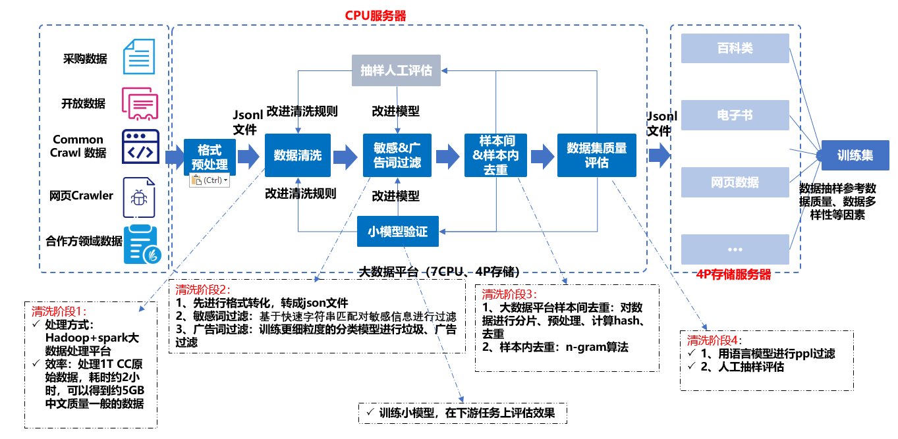

-----------------------------------------------------------------------
数据是人工智能领域发展的基础要素之一。随着大规模预训练模型及相关技术不断取得突破，在相应研究中使用高效数据处理工具提升数据质量变得越来越重要。DataCollector2集成了包含清洗、敏感词过滤、广告词过滤、语料质量自动评估等功能在内的多个数据处理工具与算法，为中国AI大模型提供安全可信的主流数据。

DataCollector2支持以下特性：

* 打造丰富且满足国家意识形态价值观的中文高质量数据。

* 通过数据处理逻辑，各环节处理逻辑差异会产生不同版本、适配不同需求的数据集。

* 可从原始html/text快速清洗得到高质量中文数据，注重敏感信息滤除，避免隐私泄露风险。

--------------------------------------------------------------------------------
## 大模型预训练语料的整体处理流程

 

大模型预训练语料清洗流程，共包括以下5个模块：

1. 语料清洗规则过滤：通常经过格式转换后的json文件仍存在很多问题，不能直接用于构建训练数据集。通常会以句子或篇章作为过滤单位，通过检测句子或篇章内是否含有大量的怪异符号、是否存在html网页标签等来判断文本是否为合格文本
2. 敏感词过滤器：过滤色情、赌博、部分低质量广告等内容的文本
3. 去重：重复粒度可分为样本间、段落间、句子间的重复，按粒度针对性的处理
4. 质量评估：采用自动评估的方法，对语料进行概率预估，文本质量越高的语句，得分越高
5. 人工评估：根据评估手册对语料进行评估，评估等级分为优、良、中、差四个等级

## 使用指南

我们提供了一系列使用指南，帮助用户快速体验FlagData的特性。
* [Tutorial 1: 清洗从互联网上获取到的原始文本](https://openi.pcl.ac.cn/LLM-Research/DataQuality/src/branch/master/DataCollector2/CleanRules)
* [Tutorial 2: 敏感词&广告词过滤](https://openi.pcl.ac.cn/LLM-Research/DataQuality/src/branch/master/DataCollector2/Adclassv5)
* [Tutorial 3: 质量评估工具](https://openi.pcl.ac.cn/LLM-Research/DataQuality/src/branch/master/DataCollector2/quality_EvaluateTool)

## 联系我们
如果你对本项目的使用和代码有任何问题，可以提交issue。同时你也可以通过邮箱 zhangy03@pcl.ac.cn 直接联系我们

## 许可证
DataCollector2项目基于 [Apache 2.0 协议](LICENSE)。

