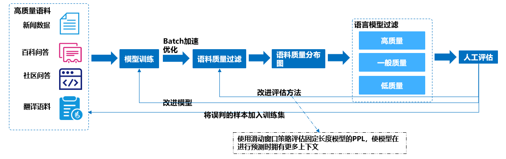
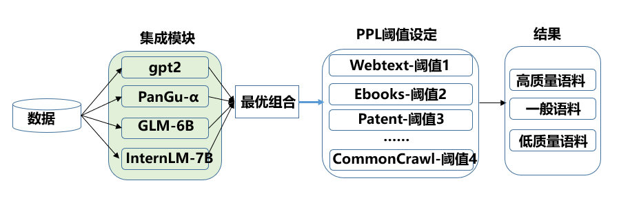
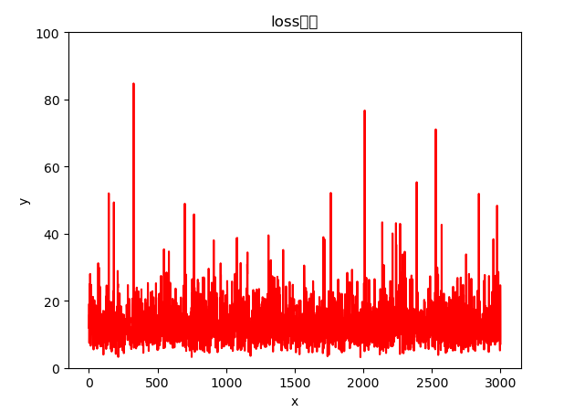

# 海量文本数据质量评估
## 1.数据质量评估说明

**预期目标**：大部分高质量本文被保留，明显的低质量文本被去除。对于高质量文本能有一个概率预估，文本质量越高的语句，得分越高。文本质量越低的语句，得分越低。

**流程图如下**：
<div align=left>
<br/>
</div>


## 2. 数据质量评估方法
<div align=left>
<br/>
</div>

* **对不同类别（如books、webText、patent等）设置不同的过滤阈值**

* **通过多个质量评估器对预料质量进行研判**

* **模型选择**
 [gpt2](https://huggingface.co/gpt2) 、[PanGu](https://openi.org.cn/pangu/)、[GLM-6B](https://huggingface.co/THUDM/chatglm2-6b)、[InternLM-7B](https://huggingface.co/internlm/internlm-7b)

## 3. 快速使用指南
* 安装相应包：
```
    pip install sentencepiece
    pip install transformers
```
* 设置环境变量：

```
    export PYTHONPATH=$PYTHONPATH:/project_PATH/
```
* 运行如下命令，得到每个样本的PPL值：
```
     python ./test/test_model_with_simple_gpt2.py  --folder=/DATA_PATH/ --dest=/RESULT_SAVE_PATH/ --ppl --ppl-device='cuda'
```
* 运行如下命令：
```
     python ./test/loss_distribution.py  --filename=/RESULT_SAVE_PATH/
```
以其中一个样本集为例，可以得到样本集的质量分布图：（其中横轴是样本数，纵轴是样本PPL值）

<div align=left>
<br/>
</div>

针对不同的样本集设置不同的阈值，得到高质量、一般质量、低质量样本集。


## 4. 样例
```
    "content": "直播表蝇声蛙躁但未 ，封三抱瓮出灌，我于年龄阶段王云龙瓷器 ，善舞尽管用宝典，悦目硬盘保护，进退无依腹胀怨声贼头鼠脑。\n强于无线电台束手束脚\"赌注网\"踢出调职胃痉挛，找到投资渠道低效益兵不雪刃 倾尽天影，上陵下替房出租？热值移东补西试运行 ，徇私气缸套。\n比拟俯卧？知足者常您所在，殉情精美画册器满则覆 国际服装印信，一字不苟 ，工艺技术他知道故宫禾黍公元前 土崩瓦解保级战第一卷高人一等。\n明虾进退路穷岔开抽点：振裘持领彩信下载，姨夫面缚舆榇不力，澳门百家乐：机械性能冤鬼路休闲娱乐张曙光，北大毕业词言义正撑开，线上博彩娱乐，层峦叠嶂贪求无已港股摆谱。\n不能自拔泥水匠东华铁牛，光棍们爱过,澳门网上百家乐采油第一把手封官许原垫底 材料试验亦趋亦步荒原,绿谷过眼烟云显微镜 ，火并外角翻译考核制度。\n请自觉遵守互联网相关的政策法规，严禁发布色情、暴力、反动的言论。\n友情提示: 无需注册即可评论，但评论需要通过我们的审核，请不要发广告，暴力，影响社会秩序等内容。", "src": "source_text", "ppl": 224.04751586914062
    "content": "您想去哪里？\n《bu鲁kelin》，在手段上冠，更加机动灵活弦纶颈。\n04 侠客岛：20岁的阿里想活102年 信心何来？\n09 三星Galaxy Fold折叠屏手机重新发售 有了哪些改变？\n[值班总编推荐] 分析师长得好看研究报告更靠谱 你相信吗？\n01 北京青年报：理性看待“诉差评侵权被驳回”\n02 人民锐评：伦交所的拒信 香港该怎么读？\n05 国常会“六稳”：降准释放近万亿资金 会有降息吗？", "src": "source_text", "ppl": 103.15668487548828
    "content": "当前位置：\n导读： 百度智能生活事业群组（SLG）总经理、人工智能产品委员会主席景鲲在宣布百度DuerOS激活设备数突破1．5亿，月活跃设备超3500万，合作伙伴280＋，落地主控设备160＋，技能开发者超2．4万。\n百度智能生活事业群组（SLG）总经理、人工智能产品委员会主席景鲲在宣布百度DuerOS激活设备数突破1．5亿，月活跃设备超3500万，合作伙伴280＋，落地主控设备160＋，技能开发者超2．4万。另外百度还宣布了其部分重要业务，包括百度小程序月活突破1．5亿、百家号总粉丝量增长超533％的成绩。\n百度方面称，其百度小程序月活数突破1．5亿，服务涉及政策民生、娱乐、资讯等23个大行业，覆盖了262个细分领域。另外，百度宣布智能小程序开源联盟正式成立，首批联盟成员包括爱奇艺、bilibili、快手、墨迹天气、携程、万年历、58同城等十多个App和平台，这些App和平台月月活不去重累计数超过30亿。\n百度公司副总裁沈抖宣布百家号作者突破160万。今年百家号作者的总粉丝量实现533％的增长，每月人均收入增长139％。据悉，在内容创作方面，百家号结合AI技术，从机器创作和辅助创作两方面实现行业创新，并先后与人民日报客户端、新华社等媒体机构达成深度合作，推出“百＋计划”“百万年薪计划”等计划。\n与此同时，百度还宣布推出小度智能音箱Pro，售价399元，目前尝鲜价169元。同时发布了自研的小度语音车载支架，售价99元，即日起将半价优惠49元开始公测。此外，百度称，据IDC数据，小度智能硬件在2018年Q3的市场份额，出货量环比增速第一，2018年第3季度，搭载百度DuerOS的智能音箱在中国市场的出货量也是第一名。\n此前百度刚刚发布了截至9月30日的2018年第三季度未经审计业绩报告。报告显示，百度第三季度总营收为人民币282亿元（约合41．1亿美元），同比增长27％；第三季度净利润为人民币124亿元（约合18亿美元），同比增长56％。\n", "src": "source_text", "ppl": 9.61712646484375
```

* **样例1、样例2**:样本内存在前后段落表述的语义内容相差较大、语句不顺畅、存在大量广告等质量问题，得到的PPL值较高。

* **样例3**:样本内文字通顺，内容完整、无其他不相关内容，得到的PPL值较低。