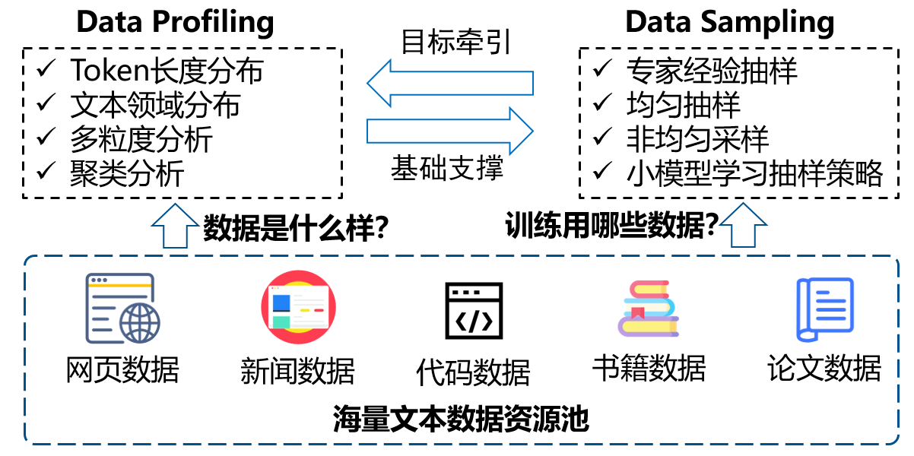
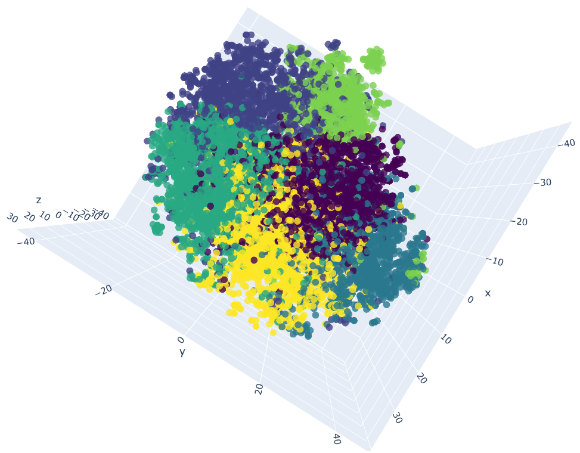

[//]: # (# 细粒度的数据画像技术 #Bert-Chinese-Text-Classification-Pytorch)
# 海量文本数据多维度数据画像技术
## 1.问题定义
* **数据资源池有哪些数据（Data Profiling）**：海量文本数据到底包含什么样的数据？从哪些维度可以对数据进行准确画像分析？
* **模型训练用哪些数据（Data Sampling）**：什么样的数据组成能够训练出更好的大模型？如何抽样？
* 数据画像分析为训练数据采样提供了前提和基础支撑；数据采样为数据画像分析提供目标牵引，两个问题相互关联，应综合统一考虑。
* 如何从信息采样与压缩理论、分层采样方法等理论基础出发，建立大语言模型海量训练数据勘察分析与数据抽样的统一方法论，是非常研究的关键问题之一。

<div align=center>
<br/>
</div>

## 2. 数据画像分析
### 中文领域分类模型
* 训练数据构建：采用GPT3.5模型API生成1W条文本分类数据、C-Eval学科数据形成了分类数据
* 模型选择：基于BERT的中文文本分类模型
* 模型训练：
```
    python run.py --model bert --data_path /DATA_PATH/ 
```
* 模型推理：
```
    python run.py --model bert --data_path /DATA_PATH/ --result_data_path /RESULT_SAVE_PATH/
```


### 文本聚类分析
* 小批量文本数据聚类及可视化分析示例：
``` 
python Kmeans_clustering_test.py
```
<div align=center>
<br/>
</div>

抽样数据聚类分析可视化结果，聚类结果可用于抽样策略的参考。
* 海量文本文本数据聚类可采用FAISS、Milvus等工具，可参考faiss_cluster_test.py

## 3. 数据采样策略
### 均匀抽样、专家经验配置抽样策略
* 提供简单均匀抽样脚本供参考，实现从jsonl数据文件中抽取均匀抽样指定比例的数据：python data_sample_function.py

### 非均匀抽样方法
* 参考[LibSampling](https://github.com/thu-vis/libsampling)提供了多种基于聚类结果、多标签分类结果的抽样方法实现。

### 小参数规模语言模型学习抽样策略
* [DoReMi](https://github.com/sangmichaelxie/doremi)提供了一种在小规模参数模型上进行数据抽样策略验证，并扩展到大预言模型的有效方法。
* 我们相信在更加细粒度的精准数据画像基础之上，能够通过小模型实现数据抽样策略的优化学习。

## 4. 鹏城脑海模型中文数据领域分布结果
### 中文文本数据领域分类体系
综合参考《中国图书馆图书分类法》与《中文学科体系分类方法》，以及已有数据情况，形成40个中文文本数据领域，包括：哲学、政治、法律、军事、经济、体育、文学、艺术、地理、历史、教育学、管理学、数学科学、物理科学、化学科学、生物科学、医学、农业科学、轻工业、重工业、交通运输、天文学、环境科学、电子信息科学、计算机科学、通信技术、材料科学、能源科学、食品科学、游戏娱乐、休闲旅游、心理学、城市规划与建设、影视影评、气象学、广告营销、电子商务、宗教、安全科学与消防工程、其他。
### 数据领域分布
* 待整理...

## Reference
[1] BERT: Pre-training of Deep Bidirectional Transformers for Language Understanding  
[2] ERNIE: Enhanced Representation through Knowledge Integration 
[3] DoReMi: Optimizing Data Mixtures Speeds Up Language Model Pretraining
