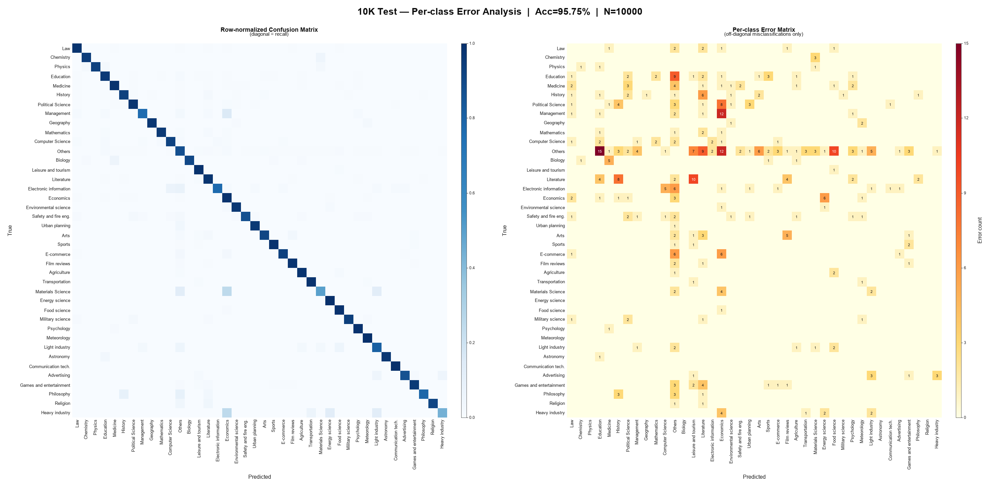

### Chinese Domain Classification Model

The filtered Chinese sub-corpus is categorized into **40 domains** using a similar method. The Chinese domain classification model is obtained by fine-tuning a **BERT-base** Chinese model. Its training dataset contains **58,689** samples (test set: **10,000** samples) and is constructed using the same procedure described above. The resulting model achieves a test accuracy of **95.75%**.

* Training Corpus: 58,689 training samples  
  Test Set Size: 10,000 samples
* Model Selection: BERT-based Chinese text classification model
* Model Training:
```
    python run.py --model bert --data_path /DATA_PATH/ 
```
* Model Inference:
```
    python run.py --model bert --data_path /DATA_PATH/ --result_data_path /RESULT_SAVE_PATH/
```

### Evaluation Results

Overall test accuracy: **95.75%** (N=10000). Macro F1: **0.9092** | Weighted F1: **0.9573**.

Row-normalized confusion matrix (left) and per-class error matrix (right):



| Domain | n | P | R | F1 |
| --- | ---: | ---: | ---: | ---: |
| Law | 495 | 0.976 | 0.984 | 0.980 |
| Chemistry | 58 | 0.965 | 0.948 | 0.957 |
| Physics | 45 | 1.000 | 0.933 | 0.966 |
| Education | 569 | 0.953 | 0.958 | 0.955 |
| Medicine | 1157 | 0.992 | 0.984 | 0.988 |
| History | 255 | 0.926 | 0.933 | 0.930 |
| Political Science | 891 | 0.984 | 0.974 | 0.979 |
| Management | 77 | 0.894 | 0.766 | 0.825 |
| Geography | 104 | 0.990 | 0.971 | 0.981 |
| Mathematics | 124 | 0.968 | 0.960 | 0.964 |
| Computer Science | 160 | 0.955 | 0.925 | 0.940 |
| Others | 846 | 0.924 | 0.878 | 0.901 |
| Biology | 84 | 1.000 | 0.905 | 0.950 |
| Leisure and tourism | 110 | 0.820 | 0.991 | 0.897 |
| Literature | 1626 | 0.979 | 0.980 | 0.979 |
| Electronic information | 75 | 0.936 | 0.773 | 0.847 |
| Economics | 1117 | 0.953 | 0.987 | 0.970 |
| Environmental science | 62 | 0.923 | 0.968 | 0.945 |
| Safety and fire engineering | 97 | 0.955 | 0.876 | 0.914 |
| Urban planning | 27 | 0.812 | 0.963 | 0.881 |
| Arts | 139 | 0.934 | 0.914 | 0.924 |
| Sports | 269 | 0.974 | 0.985 | 0.980 |
| E-commerce | 205 | 0.970 | 0.932 | 0.950 |
| Film reviews | 196 | 0.941 | 0.980 | 0.960 |
| Agriculture | 160 | 0.963 | 0.981 | 0.972 |
| Transportation | 136 | 0.971 | 0.985 | 0.978 |
| Materials Science | 16 | 0.500 | 0.500 | 0.500 |
| Energy science | 64 | 0.865 | 1.000 | 0.928 |
| Food science | 97 | 0.850 | 0.990 | 0.914 |
| Military science | 84 | 0.988 | 0.940 | 0.963 |
| Psychology | 93 | 0.902 | 0.989 | 0.944 |
| Meteorology | 54 | 0.885 | 1.000 | 0.939 |
| Light industry | 37 | 0.698 | 0.811 | 0.750 |
| Astronomy | 31 | 1.000 | 0.968 | 0.984 |
| Communication technology | 3 | 0.600 | 1.000 | 0.750 |
| Advertising | 61 | 0.946 | 0.869 | 0.906 |
| Games and entertainment | 304 | 0.973 | 0.961 | 0.967 |
| Philosophy | 33 | 0.897 | 0.788 | 0.839 |
| Religion | 23 | 1.000 | 0.913 | 0.955 |
| Heavy industry | 16 | 0.636 | 0.438 | 0.519 |

### Chinese Text Data Domain Classification System

By comprehensively referencing the "Chinese Library Classification" and the "Chinese Academic Discipline Classification Method", along with existing data conditions, a system of 40 Chinese text data domains has been established, including: "Law", "Chemistry", "Physics", "Education", "Medicine", "History", "Political Science", "Management", "Geography", "Mathematics", "Computer Science", "Others", "Biology", "Leisure and tourism", "Literature", "Electronic information", "Economics", "Environmental science", "Safety and fire engineering", "Urban planning", "Arts", "Sports", "E-commerce", "Film reviews", "Agriculture", "Transportation", "Materials Science", "Energy science", "Food science", "Military science", "Psychology", "Meteorology", "Light industry", "Astronomy", "Communication technology", "Advertising", "Games and entertainment", "Philosophy", "Religion", "Heavy industry".


